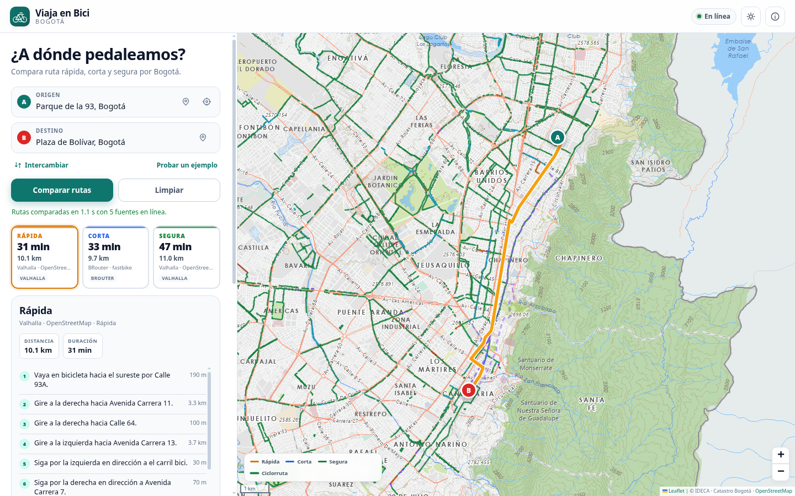
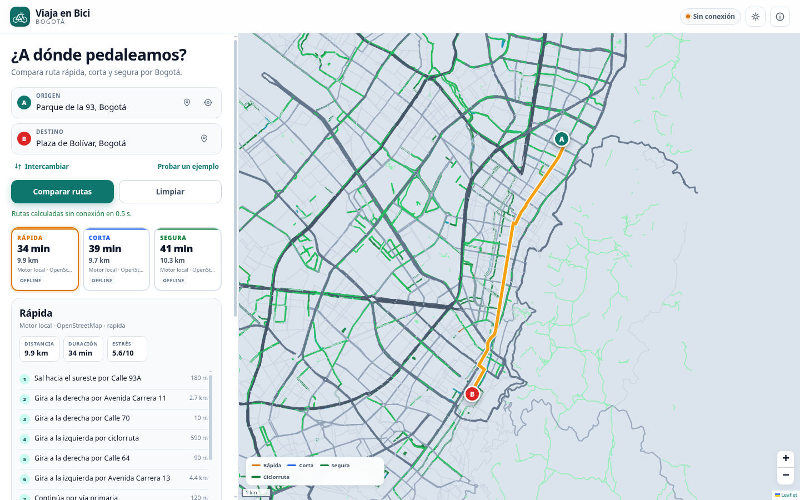
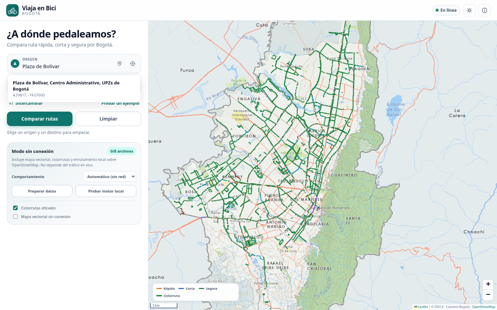
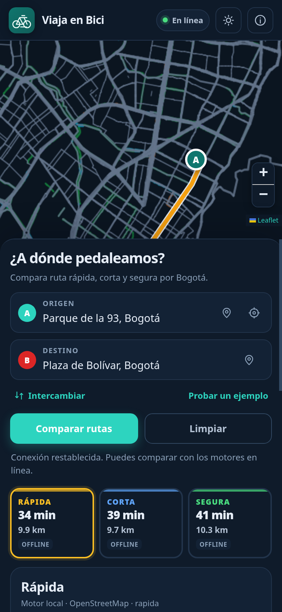

# Viaja en Bici

Aplicación de rutas ciclistas para Bogotá. Compara tres perfiles —**rápida**, **corta** y **segura**—, dibuja las ciclorrutas oficiales y puede calcular rutas **sin conexión** en el propio dispositivo, sin depender de que el mapa o una respuesta anterior sigan en caché.

> Estado: MVP funcional de web + Android (APK debug). La publicación en GitHub está pendiente de autenticación; ver [Estado y pendientes](#estado-y-pendientes).



## Qué incluye

- **Mapa de Bogotá** con el Mapa Base oficial de IDECA/Catastro Distrital (claro y oscuro) y la capa oficial de **6.311 ciclorrutas** del IDU.
- **Búsqueda de direcciones** con Nominatim, limitada a Bogotá y con caché y control de frecuencia.
- **Comparación real de rutas**:
  - más rápida por duración;
  - más corta por distancia;
  - segura, con el perfil de Valhalla que prioriza ciclorrutas y evita vías de mayor tráfico;
  - alternativas de BRouter y de la API de Ruteo de Mapas Bogotá.
- **Instrucciones giro a giro** cuando el motor las entrega (Valhalla y Mapas Bogotá).
- **Origen/destino** por texto, clic en el mapa, marcador arrastrable o geolocalización.
- **Modo sin conexión real**:
  - grafo ciclable propio de OpenStreetMap (320.191 nodos y 358.236 aristas);
  - mapa base vectorial local;
  - ciclorrutas oficiales empaquetadas;
  - Dijkstra en un Web Worker con métricas de distancia, tiempo y seguridad;
  - service worker para el armazón de la PWA y los datos.
- **Android** con Capacitor, paquete `co.viajaenbici.app`, nombre «Viaja en Bici», iconos y splash propios.
- Interfaz responsive en español, temas claro/oscuro, estado de conexión y persistencia de la última consulta.

| Rutas en línea | Sin conexión, mapa vectorial |
| --- | --- |
|  |  |

| Búsqueda de direcciones | Móvil |
| --- | --- |
|  |  |

## Inicio rápido

Requisitos: Node.js ≥ 22.12 y npm. El proyecto fue probado con Node 26.11.1 y npm 12.2.1.

```bash
cd /data/Proyectos/viajaEnBici
npm install
npm run dev          # http://127.0.0.1:5173
```

La app funciona sin variables de entorno ni claves API. Los datos de Bogotá ya están incluidos en `public/data/`.

```bash
npm test             # pruebas de geometría, normalización y motor offline
npm run build        # comprueba tipos y genera dist/
npm run preview      # sirve dist/ en http://127.0.0.1:4173
npm run verify:fuentes
```

`verify:fuentes` consulta los servicios reales (Valhalla, BRouter, Mapas Bogotá, Nominatim, ArcGIS, IDECA y Overpass) y devuelve código 1 si falla una fuente crítica. Los servicios públicos pueden tardar o limitar peticiones.

## Android

El proyecto nativo está en `android/` y el APK debug ya compilado en:

```text
android/app/build/outputs/apk/debug/app-debug.apk
```

Para regenerarlo:

```bash
npm run android:apk
```

Requiere Android SDK con plataforma 36 y JDK 21. En CachyOS, los pasos exactos (instalación del SDK, permisos, firma y solución de problemas) están en [docs/ANDROID.md](docs/ANDROID.md).

Datos verificados del APK:

```text
package: co.viajaenbici.app
versionName: 0.1.0
minSdk: 24
targetSdk: 36
application-label: Viaja en Bici
tamaño: 12 MB
```

No se ha probado en un teléfono físico ni en un emulador porque no había dispositivo conectado. El APK compila y su manifiesto, recursos y datos empaquetados fueron verificados.

## Cómo funciona la comparación

```text
Origen/destino
      │
      ├── Valhalla (rápida, corta, segura) ─┐
      ├── BRouter (fastbike) ──────────────┤
      └── Mapas Bogotá (hasta 3 rutas) ────┘
                                             │
                         normalización + selección
                                             │
        rápida = menor duración · corta = menor distancia
        segura = perfil seguro de Valhalla (o respaldo local)
```

Si los servicios en línea fallan, la app intenta el motor local como respaldo. Si el usuario elige «Siempre sin conexión» o no hay red, calcula directamente con el grafo local.

La selección no falsea etiquetas: las tarjetas muestran la fuente real de cada ruta y los tiempos son estimaciones de cada motor. La ruta «corta» puede venir de BRouter y la «rápida» de Valhalla.

## Datos offline

| Archivo | Uso | Tamaño |
| --- | --- | --- |
| `public/data/grafo-bogota.json.gz.bin` | grafo ciclable comprimido | 4,62 MB |
| `public/data/base-bogota.geojson` | mapa base vectorial | 3,56 MB |
| `public/data/ciclorrutas.geojson` | capa oficial de ciclorrutas | 3,8 MB |

El grafo se construye desde OpenStreetMap con `scripts/fetch-osm.mjs` y `scripts/build-offline-graph.mjs`. Se deduplican aristas, se conservan sentidos viales y se asignan velocidad y estrés por tipo de vía. La app lo descarga comprimido, lo descomprime con `DecompressionStream` y lo procesa en un Web Worker.

El modo offline no es «guardar tiles»: incluye un mapa vectorial propio y un motor de rutas local. Los detalles, límites y verificación real están en [docs/OFFLINE.md](docs/OFFLINE.md).

## Documentación

- [Arquitectura](docs/ARQUITECTURA.md): módulos, flujo de datos, decisiones técnicas.
- [Fuentes y APIs](docs/FUENTES.md): endpoints probados, CORS, licencias y limitaciones.
- [Modo sin conexión](docs/OFFLINE.md): estrategia, empaquetado y pruebas.
- [Android](docs/ANDROID.md): CachyOS, SDK, compilación y APK.
- [Pruebas](docs/PRUEBAS.md): comandos, resultados reales y pendientes.

## Estructura

```text
src/
  config.ts              configuración de app, capas y endpoints
  types.ts               tipos compartidos
  lib/
    geo.ts               distancias, rumbos, polilíneas
    geocoding.ts         Nominatim y geolocalización
    map.ts               Leaflet, capas y marcadores
    offline-pack.ts      caché del paquete offline
    routing/
      valhalla.ts        normalización de Valhalla
      brouter.ts         normalización de BRouter
      mapas-bogota.ts    API de Ruteo de Mapas Bogotá
      offline-graph.ts   grafo, índice, Dijkstra y pasos
      offline.worker.ts  Web Worker
      offline-client.ts  cliente del worker
      compare.ts         comparación y respaldo
  ui/app.ts              controlador de la interfaz
public/
  data/                  datos de Bogotá
  sw.js                  service worker
scripts/                 descarga y construcción de datos
tests/                   Vitest
android/                 proyecto Capacitor Android
docs/                    documentación y capturas
```

## Estado y pendientes

Completado y verificado:

- Web funcional con rutas reales de Valhalla, BRouter y Mapas Bogotá.
- Capa oficial de ciclorrutas y mapa base IDECA.
- Motor offline real con rutas de ~9,7–10,3 km en 0,5 s tras la carga.
- Service worker y recarga completa sin red.
- Pruebas automatizadas y APK debug compilado.

Pendiente o condicionado:

1. **Publicación en GitHub**: `gh` no está autenticado y el repositorio remoto aún no existe. El usuario debe ejecutar `gh auth login` (o aportar un token) para crear y subir `https://github.com/cudox/viajaEnBici`.
2. **Prueba en dispositivo Android**: no hay `adb` con dispositivo conectado ni emulador; el APK no se ha abierto en un teléfono.
3. **Servicios públicos**: Valhalla FOSSGIS, BRouter, Nominatim y las APIs de Bogotá son demostraciones. Para producción deben autohospedarse o revisarse sus políticas y límites.
4. **Datos estáticos**: el grafo es una foto de OpenStreetMap. No hay actualización automática ni tráfico en vivo.
5. **`/buscar2` de Mapas Bogotá**: el endpoint respondió `{"status":false}` con los parámetros probados. No se integra; la búsqueda usa Nominatim.
6. **Firma de producción**: el APK generado es debug. Publicar en Play Store requiere keystore y un build release firmado.

## Licencias

El código de este repositorio se distribuye bajo licencia MIT (ver `LICENSE`). Los datos y servicios tienen sus propias licencias:

- OpenStreetMap: © colaboradores de OpenStreetMap, ODbL 1.0.
- Ciclorrutas: IDU / Catastro Distrital, datos abiertos de Bogotá; consultar términos de uso.
- Mapa Base: IDECA / UAECD, Catastro Bogotá.
- Valhalla, BRouter, Nominatim y FOSSGIS: servicios públicos con sus respectivas políticas de uso.
- Leaflet: BSD-2-Clause.

Ver [docs/FUENTES.md](docs/FUENTES.md) para atribuciones y condiciones.
